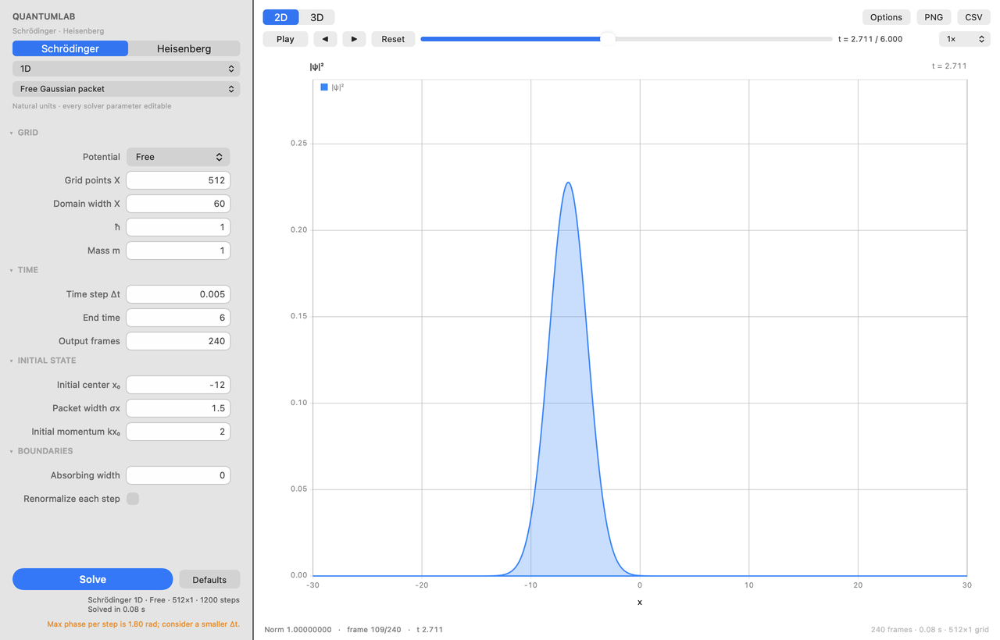
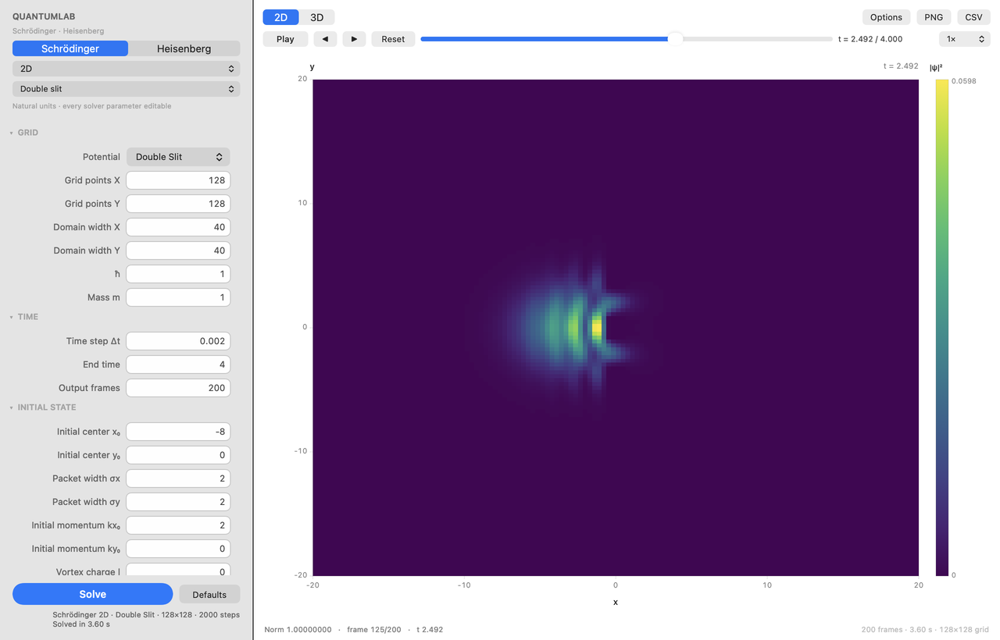
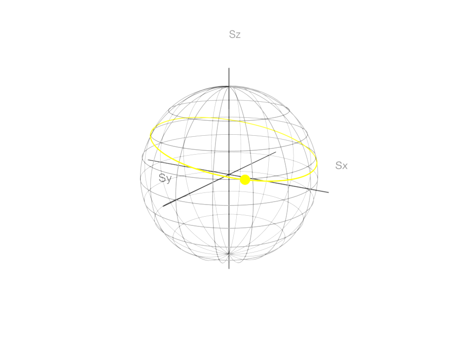
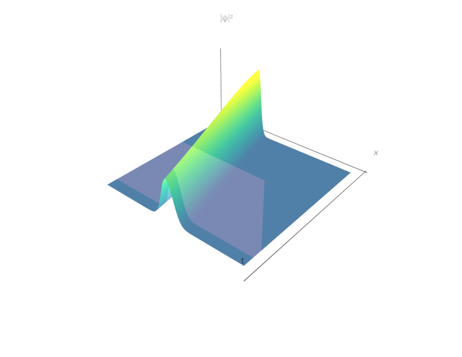
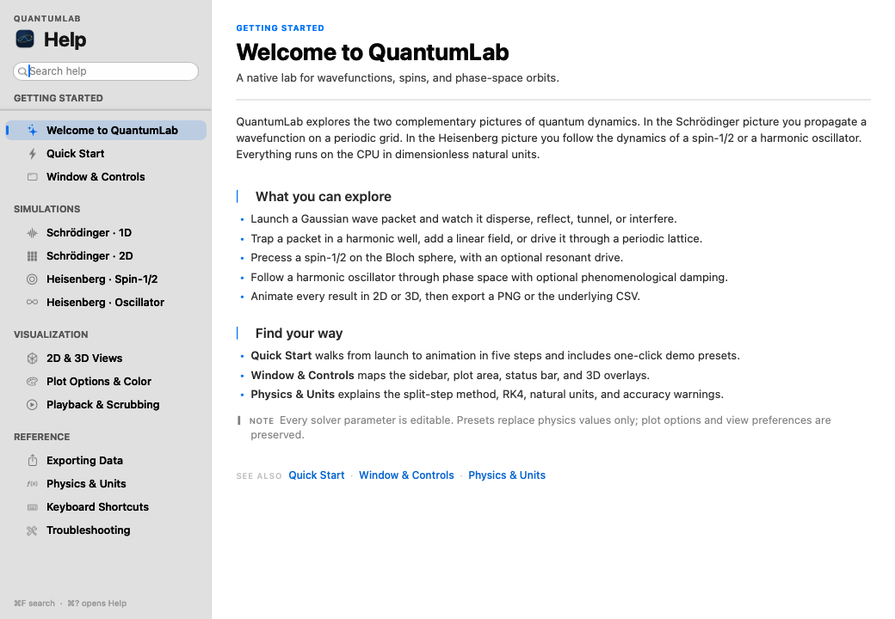

# QuantumLab

A native macOS application for exploring two complementary pictures of quantum dynamics:

- the **Schrödinger equation** in one and two spatial dimensions, solved with the split-step Fourier method;
- the **Heisenberg equation** for a spin-1/2 system and a damped harmonic oscillator, solved with classical Runge–Kutta 4.

The interface, solvers, plots, animation, and export functionality are written in Objective-C with AppKit, Core Graphics, and SceneKit. There are no third-party runtime dependencies.



| Double-slit density | Bloch-sphere trajectory |
|---|---|
|  |  |

The Schrödinger 3D view renders a bright height-mapped spacetime surface with a moving time cursor:



## Requirements

- macOS 14.0 or newer
- Xcode command line tools (tested with the macOS 27 SDK)
- [XcodeGen](https://github.com/yonaskolb/XcodeGen) only if you want to regenerate the project file

The repository includes a generated `QuantumLab.xcodeproj`, so XcodeGen is not required to build the checked-in project.

## Build and run

From the repository root:

```sh
# Generate the project again after changing project.yml (optional)
xcodegen generate

# Build
xcodebuild \
  -project QuantumLab.xcodeproj \
  -scheme QuantumLab \
  -configuration Debug \
  -destination 'platform=macOS' \
  -derivedDataPath build \
  CODE_SIGNING_ALLOWED=NO \
  build

# Numerical checks without opening a window
./build/Build/Products/Debug/QuantumLab.app/Contents/MacOS/QuantumLab --selftest

# Debug-only UI smoke test (exercises the window and all four simulation modes)
./build/Build/Products/Debug/QuantumLab.app/Contents/MacOS/QuantumLab --uitest

# Launch the application
open build/Build/Products/Debug/QuantumLab.app
```

A successful self-test ends with a line such as `16 passed, 0 failed`. The UI smoke test exits with status 0 when every check passes; it writes temporary screenshots and CSV files under `/tmp/quantumlab-ui-*`.

## Features

- **Schrödinger picture, 1D**
  - free, harmonic, barrier, double-barrier, linear-field, and periodic-lattice potentials;
  - Gaussian packets with initial position, width, momentum, and normalization;
  - optional absorbing boundaries and per-step renormalization;
  - density plot with optional real/imaginary parts and scaled potential.
- **Schrödinger picture, 2D**
  - free, harmonic, double-slit, circular-well, and periodic-lattice potentials;
  - Gaussian packets with optional vortex charge;
  - density heatmap, optional phase heatmap, logarithmic density display, color maps, and color bar.
- **Heisenberg picture**
  - spin-1/2 precession in static and sinusoidally driven magnetic fields, visualized as component time series and a Bloch sphere trajectory;
  - harmonic oscillator phase portrait, time series, and `(t, x, p)` curve, with optional phenomenological damping.
- **Every solver parameter is editable** in the generated parameter form. Parameter groups collapse and potential-specific fields appear only when relevant.
- **Built-in presets** for the main physical demonstrations.
- **Playback**: play/pause, step, scrub, reset, and 0.25×–4× speed.
- **2D and 3D views** with a shared current frame, so switching views keeps your place. Schrödinger 3D surfaces use a bright height ramp, and a floating **Center** button recenters the 3D camera.
- **PNG and CSV export** through standard macOS save panels.
- **Validation and guardrails** for grid sizes, time steps, memory, and invalid combinations.
- **Background solves** with progress reporting and cancellation.
- **State persistence** of the last mode, system, parameters, plot options, and view.
- **Dark-mode-aware AppKit controls** and a resizable window.
- **A searchable Help window** with 14 task-oriented topics, live filtering, highlighted matches, cross-topic links, and one-click links that launch demo presets.
- **A native app icon** bundled in `Assets.xcassets/AppIcon.appiconset` and applied in the Dock and About panel.

## Using the application

1. Choose **Schrödinger** or **Heisenberg** at the top of the sidebar.
2. Choose a system: `1D`, `2D`, `Spin-1/2`, or `Harmonic Oscillator`.
3. Pick a preset or edit any parameter group.
4. Press **Solve** (⌘R). While a solve is running the button becomes **Cancel**.
5. Use the playback row to animate, step, or scrub. Space toggles play/pause when the plot area has focus; the left and right arrows step frames.
6. Switch between **2D** and **3D** with the segmented control (⌘1 / ⌘2). In 3D, use the **Center** button at the upper-right of the plot to recenter and reset the camera.
7. Open **Options** for color map, log density, phase, real/imaginary components, 3D mesh resolution, and auto-rotation.
8. Export the current plot with **PNG** (⌘E) or the underlying data with **CSV** (⇧⌘E).
9. Open **Help → QuantumLab Help** (⌘?) for the searchable guide. Press ⌘F to focus search; press Esc to clear the search or close Help when the field is empty.

You can also use the menu bar:

- **Simulation**: Solve, Play/Pause, Step Back, Step Forward, Reset Frame.
- **View**: 2D, 3D, Toggle Sidebar, Reset 3D Camera.
- **File**: Export Plot PNG, Export Data CSV.
- **Help**: QuantumLab Help, Quick Start, Keyboard Shortcuts, Troubleshooting.

### Help window

Choose **Help → QuantumLab Help** (⌘?) to open the guide in its own resizable window. It stays out of the way of the simulation and remembers its size and sidebar width.



- The sidebar organizes 14 topics into **Getting Started**, **Simulations**, **Visualization**, and **Reference**.
- Typing in the search field filters topics as you type, selects the best match, and highlights every occurrence in the title, subtitle, and body.
- Links in the body or **See also** rows jump to related topics. The **Try it** links in simulation topics apply a preset, close Help, and start the solve in the main window.
- **⌘F** focuses search from anywhere in Help. **Esc** clears a non-empty search, or closes the window when the field is empty. The **Clear the search** link in the empty state does the same thing.
- **Help** menu shortcuts jump directly to Quick Start, Keyboard Shortcuts, and Troubleshooting, and focus the search field.

### CSV layout

- **Schrödinger 1D:** `time,x,re,im,density` for the current frame.
- **Schrödinger 2D:** `x,y,density` for the current frame, plus `phase` when phase storage is enabled.
- **Spin-1/2:** `t,Sx,Sy,Sz,|S|` for every output frame.
- **Harmonic oscillator:** `t,x,p,energy` for every output frame.

PNG export captures the currently visible plot. 3D PNGs use the SceneKit snapshot at the current frame.

## Physics and numerics

### Schrödinger equation

\[
i\hbar\frac{\partial\psi}{\partial t}
= -\frac{\hbar^2}{2m}\nabla^2\psi + V(\mathbf r)\psi
\]

The spatial domain is periodic and centered on the origin. The solver uses the symmetric split-step Fourier scheme:

1. half potential kick, \(\exp(-iV\Delta t/2\hbar)\);
2. full kinetic propagation in Fourier space, \(\exp(-i\hbar k^2\Delta t/2m)\);
3. second half potential kick.

1D transforms use an in-house radix-2 Cooley–Tukey FFT. 2D transforms use row FFTs followed by column FFTs. The Strang splitting is second-order accurate and unconditionally stable; accuracy is controlled by \(\Delta t\), the potential strength, and the maximum kinetic phase. The app reports a warning when the maximum phase per step becomes large.

#### Initial wave packets

1D:

\[
\psi_0(x)=A\exp\!\left(-\frac{(x-x_0)^2}{4\sigma_x^2}\right)e^{ik_0x}
\]

2D:

\[
\psi_0(x,y)=A\exp\!\left(-\frac{(x-x_0)^2}{4\sigma_x^2}
-\frac{(y-y_0)^2}{4\sigma_y^2}\right)
e^{i(k_{x0}x+k_{y0}y)}e^{il\theta}
\]

The normalization constant \(A\) is computed from the discrete grid so that
\(\sum |\psi|^2\Delta x\Delta y=1\) at \(t=0\).

#### Absorbing boundaries

When the absorbing width is positive, a quadratic mask is applied inside a boundary band:

\[
W(x)=W_0\left(\frac{d(x,\partial\Omega)}{d_{\text{abs}}}\right)^2,
\qquad
\psi\leftarrow\psi\exp(-W\Delta t/\hbar).
\]

This suppresses periodic wraparound for scattering calculations. Norm loss is then expected and is reported in the status bar.

### Heisenberg equation

The general equation is

\[
\frac{dA}{dt}=\frac{i}{\hbar}[H,A]+\frac{\partial A}{\partial t}.
\]

#### Spin-1/2

\[
H=-\frac{\gamma\hbar}{2}\mathbf B(t)\cdot\boldsymbol\sigma,
\qquad
\frac{d\mathbf S}{dt}=\gamma\mathbf S\times\mathbf B(t).
\]

The Bloch vector is initialized from polar and azimuthal angles, and the trajectory is integrated with RK4. A static field plus a sinusoidal drive along a selected axis is supported. The Bloch vector is plotted as a unit vector; its magnitude is checked numerically.

#### Harmonic oscillator

\[
H=\frac{p^2}{2m}+\frac12m\omega^2x^2
\]

with Heisenberg equations

\[
\frac{dx}{dt}=\frac{p}{m},\qquad
\frac{dp}{dt}=-m\omega^2x-2\gamma_d p.
\]

The damping term is **phenomenological**, not part of the Hamiltonian. It defaults to zero.

### Units

The application uses **dimensionless natural units**. \(\hbar\) and \(m\) are editable in the Schrödinger model. There is no conversion between SI, atomic units, and natural units. Frequencies, fields, and times are expressed in the app's natural units.

## Parameter reference

All parameters are exposed in the sidebar; the table below summarizes the main groups.

### Schrödinger

| Key | Meaning | Default / range |
|---|---|---|
| `potential` | Potential model | Free |
| `nx`, `ny` | Grid points | 512 (1D), 128×128 (2D); powers of two, 32–2048 |
| `lx`, `ly` | Domain widths | 60 (1D), 40 (2D) |
| `hbar`, `mass` | Natural constants | 1; positive |
| `dt`, `tmax` | Time step and end time | 0.005 / 6 (1D), 0.002 / 4 (2D) |
| `frames` | Output frames | 240 (1D), 200 (2D) |
| `x0`, `y0` | Packet center | −12 (1D), −8 / 0 (2D) |
| `sigmaX`, `sigmaY` | Packet widths | 1.5 (1D), 2 / 2 (2D) |
| `kx0`, `ky0` | Initial momentum | 2 / 0 |
| `vortex` | 2D vortex charge | 0–3 |
| `v0` | Potential strength | 20 (1D), 50 (2D) |
| `omega` | Harmonic trap frequency | 1 |
| `barrierX`, `barrierWidth` | Barrier position and width | 0 / 1 |
| `barrierSeparation` | Double-barrier separation | 6 |
| `wallThickness`, `slitSeparation`, `slitWidth` | 2D double-slit geometry | 1 / 4 / 2 |
| `wellRadius`, `latticePeriod` | Circular well and lattice geometry | 5 / 4 |
| `field` | Linear field strength | 0.5 |
| `absWidth`, `absStrength` | Absorbing boundary | 0 (off) / 20 |
| `renormalize` | Renormalize after every step | off |
| `storePhase` | Store 2D phase frames (2× density memory) | off |

### Heisenberg

| Key | Meaning | Default / range |
|---|---|---|
| `dt`, `tmax`, `frames` | Integration controls | 0.002 / 20 / 400 |
| `theta0`, `phi0` | Initial spin angles (degrees) | 80° / 0° |
| `gamma` | Gyromagnetic ratio | 1 |
| `bx`, `by`, `bz` | Static magnetic field | (0.2, 0, 1) |
| `driveAmp`, `driveFreq`, `drivePhase`, `driveAxis` | Resonant drive | off; amplitude 0 |
| `mass`, `omega` | Oscillator parameters | 1 / 1 |
| `x0`, `p0` | Initial oscillator state | 1 / 0 |
| `damping` | Phenomenological damping \(\gamma_d\) | 0 |

### Plot options

Color map (Viridis, Inferno, CoolWarm, Grayscale), log density, show potential, show 2D phase, show real/imaginary components, 3D mesh resolution (64/96/128/192), and auto-rotate are saved separately from physics parameters.

## Presets

The preset menu offers:

| Mode | Presets |
|---|---|
| Schrödinger 1D | Free Gaussian packet, Harmonic coherent state, Tunneling barrier |
| Schrödinger 2D | Free Gaussian packet, Double slit, Vortex packet |
| Spin-1/2 | Spin precession, Driven spin |
| Harmonic oscillator | Oscillator phase space |

The popup also shows **Custom** after you edit a value or switch modes/systems while keeping compatible values. Presets replace physics parameters only; plot preferences are preserved.

## Validation and resource limits

- \(N_x\) and \(N_y\) must be powers of two between 32 and 2048.
- 2D output is limited to 800 frames and approximately 1.5 GB; runs above 512 MB produce a warning.
- Total internal steps are capped at 2,000,000.
- The app warns when the initial packet approaches the domain edge or the absorbing band is wider than half the domain.
- The maximum split-step phase is reported when it is large; reduce \(\Delta t\) if the warning is significant.

## Project layout

```
QuantumLab/
├── main.m, AppDelegate.*, QLMainWindowController.*
├── QLHelpWindowController.*
├── QLParameterFormView.*, QLParameterRow.*
├── QL2DPlotView.*, QL3DPlotView.*
├── QLColorMap.*, QLPlotStyle.*
├── QLUITest.* (Debug-only UI smoke test)
├── Model/
│   ├── QLFFT.*, QLPotential.*
│   ├── QLParameterDefinition.*, QLParameterSet.*, QLParameterCatalog.*
│   ├── QLSimulationConfig.*, QLSimulationResult.*
│   ├── QLSchrodingerSolver.*, QLHeisenbergSolver.*
│   └── QLSelfTest.*
├── Assets.xcassets/AppIcon.appiconset
└── Resources/Info.plist
```

The numerical model layer has no AppKit dependencies, which allows it to run under `--selftest` without a window server.

## Self-tests

`--selftest` checks:

- 1D and 2D FFT round trips;
- Schrödinger 1D and 2D solves and norm conservation;
- free-packet spreading against the analytic width;
- harmonic coherent-state period and half-period inversion;
- spin Larmor return and Bloch-vector magnitude;
- undamped oscillator energy conservation.

Exit status is zero only when every check passes.

### UI smoke test

The Debug build also has a windowed `--uitest` harness. It drives the real controls and checks:

- app metadata, icon loading, menu wiring, and keyboard shortcuts;
- all four simulation modes and their parameter forms, presets, groups, visibility rules, and validation;
- playback, frame stepping, scrubbing, speed changes, view switching, the floating **Center** overlay, plot options, color maps, and mesh resolution;
- the Help window: every topic, live search and match highlighting, empty state, cross-topic and clear-search links, preset launching, menu routing, sidebar constraints, resizing, and dark-mode layout;
- PNG/CSV data generation, save-panel opening/cancellation, dark/light appearance, window resizing, sidebar toggling, 2D hover handling, and state persistence;
- finite result data and normalized initial states for each solver.

The harness currently runs more than 700 checks. Help snapshots are written to `/tmp/quantumlab-ui-help-*.png`; other screenshots and CSV files use `/tmp/quantumlab-ui-*`.

It is a developer QA utility and is compiled out of Release builds.

## Limitations

- No arbitrary matrix Hamiltonians or N-level systems.
- No relativistic quantum mechanics, quantum field theory, open-system master equations, multi-particle entanglement, or tensor-network solvers.
- CPU numerics only; SceneKit is used solely for rendering.
- No physical unit conversion.
- Potentials are selected from a curated list; custom potential formulas are not supported.
- 2D frames store density (and optionally phase) rather than full complex wavefunctions.
- SceneKit is deprecated in recent SDKs. The project suppresses deprecation warnings and isolates SceneKit in `QL3DPlotView`; a future SDK removal would require a Metal rewrite.
- The 3D surface is normalized into a unit box; actual extrema are shown in the HUD and status bar.
- Damping in the oscillator is phenomenological and is explicitly labeled as such.

## Troubleshooting

- **`xcodebuild: error: ... scheme not found`** — regenerate with `xcodegen generate`, or open `QuantumLab.xcodeproj` in Xcode and build the `QuantumLab` scheme.
- **App launches but is off screen** — the window frame is restored from user defaults. The app recenters the window if the saved frame does not intersect a screen. You can also reset the saved frame:
  `defaults delete com.sid.QuantumLab "NSWindow Frame QuantumLabMainWindow"`.
- **Help window is in an odd position or layout** — Help also restores its frame and divider width. Reset them with:
  `defaults delete com.sid.QuantumLab "NSWindow Frame QuantumLabHelpWindow"`
  `defaults delete com.sid.QuantumLab "NSSplitView Subview Frames QuantumLabHelpSplitView"`.
- **No GUI in a headless/CI session** — use `--selftest` for numerical verification; AppKit still requires a logged-in macOS session for the window.
- **SceneKit deprecation warnings** — expected; they are suppressed by `-Wno-deprecated-declarations`.
- **Exports** — the app uses standard save panels and requires a writable destination. No sandbox entitlement is enabled.

## License

This project is a local educational application. Add a license here if you plan to distribute it.
